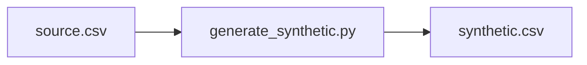

# Synthetic Data Generator

Creates a simple synthetic tabular dataset without copying rows verbatim. Numeric fields are sampled from clipped empirical distributions with noise; categorical fields are sampled from observed frequencies. The included comparison report measures distribution similarity and exact-row overlap.

[Research notes](docs/RESEARCH.md) · [Architecture](docs/ARCHITECTURE.md) · [Execution record](docs/RESULTS.md) · [Project site](docs/index.html)

---

## Research context

How well does simple tabular resampling preserve distributions without reproducing sensitive records?

The repository provides an inspectable implementation of **synthetic tabular data baseline**. It is an exploratory engineering project; broader effectiveness and practical deployment require further study.

## Implemented capabilities

- Synthetic tabular data baseline

## Architecture



The diagram is a simplified view of the supplied implementation. Detailed modules and interface assumptions are in [architecture notes](docs/ARCHITECTURE.md).

## Run locally

**Environment:** Python 3.11+ is the documented baseline. Install optional services or hardware drivers when required. Dependencies: pandas, numpy, scipy.

```bash
python -m venv .venv
source .venv/bin/activate       # Windows: .venv\Scripts\activate
python -m pip install -r requirements.txt
```

Run the following commands from the repository root:

```bash
python src/generate_synthetic.py sample/source.csv --rows 500 --output outputs/synthetic.csv
```

**Input:** `sample/source.csv`

## Results

**Executed locally** with the included input files. This is an implementation check, not an independently validated benchmark.


| Observed field | Value |
|:--|--:|
| Exact row overlap count | 0 |
| Exact row overlap percent | 0 |

**Execution evidence:** [Full command transcript](results/execution.txt) · [Inputs and checksums](results/execution.json)

**Saved outputs**

- [`synthetic.csv`](results/artifacts/synthetic.csv)

The values above come from the bundled fixtures. Model scores, simulated costs, and resource-use estimates should not be interpreted as real-world deployment results.

## Source structure

- [`src/generate_synthetic.py`](src/generate_synthetic.py)

Documentation is in [`docs/`](docs/). Bundled inputs remain in their original folders. The original project instructions are archived in [`docs/ORIGINAL_README.md`](docs/ORIGINAL_README.md).

## Limits and next research steps

- Results shown here are from local bundled inputs; they are not published research findings or evidence of external deployment.
- Validate domain assumptions and compare against a documented baseline before making performance or reliability claims.
- Extend testing to larger, independently sourced datasets and report reproducibility, failures and relevant ethical risks.

For the methodology and evaluation design, see [the research brief](docs/RESEARCH.md).

## License

See [`LICENSE`](LICENSE). No affiliation, patent, publication, production deployment or independent endorsement is implied.
