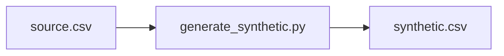

# Architecture — Synthetic Data Generator

## Inputs

- `sample/source.csv`

## Source files

- `src/generate_synthetic.py`

## Output

- `results/artifacts/synthetic.csv`

This representation is intended for source navigation. It does not imply a production deployment or undisclosed components. The editable diagram is available as [`architecture.mmd`](architecture.mmd).
